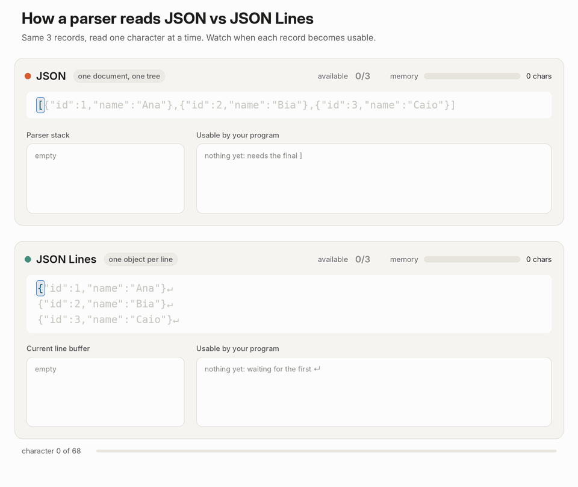

JSON and JSONL are text-based data formats used to store and exchange structured information. They look similar because both use JSON syntax, but they differ in how data is organized and parsed.

Essentially: 

- JSON (JavaScript Object Notation) is a standardized data interchange format.
- JSONL (JSONLines) is a extension of JSON for specific tasks


JSON: 

```json
[
  {
    "name": "Alice",
    "age": 30,
    "skills": ["Python", "JavaScript"]
  },
  {
    "name": "Bob",
    "age": 25,
    "skills": ["Java", "C++"]
  }
]
```


JSONL

```JSON
{"name": "Alice", "age": 30, "skills": ["Python", "JavaScript"]}
{"name": "Bob", "age": 25, "skills": ["Java", "C++"]} 
```

## The main difference: Structure and parsing

**JSON** represents a single valid JSON value, which can be an object, array, string, number, boolean, or null.

For example, when storing multiple records in JSON, we commonly organize them into an array of objects.

When parsing JSON with a **traditional parser**, we need to process the entire document, respecting the surrounding structure like brackets, commas, and nested elements before returning the parsed result. See the GIF bellow 

However, there is another approach to parsing JSON: **streaming parsers**.

A streaming parser is a parser that processes data incrementally, rather than requiring the entire document to be loaded into memory before parsing begins.


**JSONL**, on the other hand, stores each record as an independent JSON value separated by a newline. Because of this, it is also called **NDJSON (Newline Delimited JSON)**.

This means we can read and parse the file **one line at a time**, without needing to load or parse the entire file.

Keep in mind that JSONL is not simply JSON without indentation. It changes how records are delimited, allowing them to be processed independently and faster.

### How a Parser reads JSON and JSON Lines



## Why use JSONL instead of a streaming JSON parser?

_What? You must be thinking, so why should I use JSONL instead of changing the parser for JSON in tasks that require streaming and incremental reading?_

Because JSONL is **Simple By Design**.

Instead of handling the entire processing pipeline just to fit the JSON data format, why not use JSONL?

We can pass each line of JSONL to a normal JSON parser instead of needing a specialized one.

## When should we use each format?

JSON is great for structured data, API contracts, and data exchange for nested object relationships between web services "nodes", configuration files, or documents that need to be represented as a single structured value.

JSONLines is great for streaming data, append-only workloads (like logs), and efficient writing and reading because it allows us to process individual lines without the need to parse the entire document.
